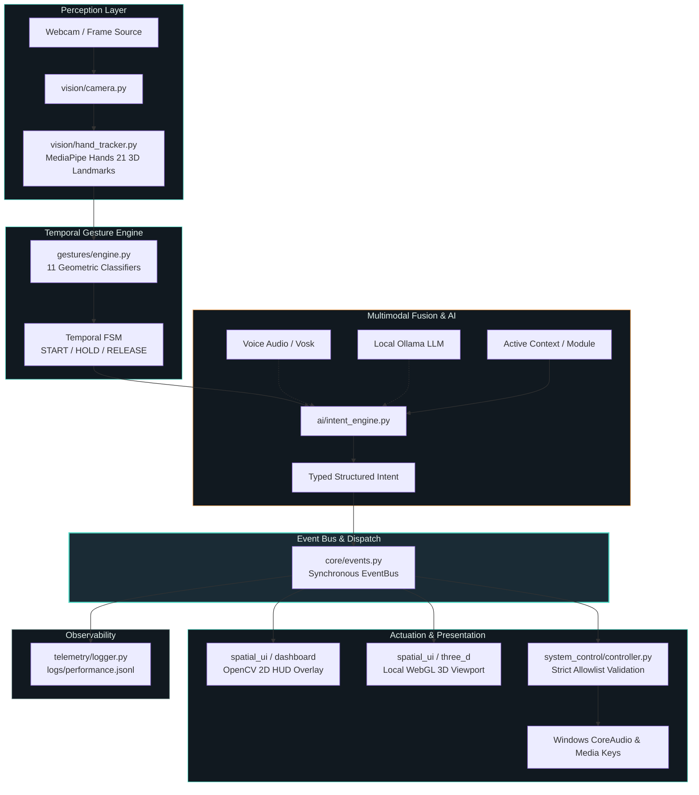

# CYBERNETIC OS

**AI-Powered Multimodal Spatial Computer Interface**

> **Cybernetic OS is a real-time multimodal spatial computer interface that combines computer vision, hand gestures, contextual intent recognition, local AI, and 3D interaction to create a touchless human-computer interaction layer.**

Designed for low-latency, privacy-first spatial interaction on personal workstations, CYBERNETIC OS bridges raw computer vision perception with safe, deterministic operating system actions and immersive 3D spatial viewports.

---

## Feature Matrix

| Capability | Status | Notes |
|---|---|---|
| **Real-time Hand Perception** | **Implemented** | 21 3D landmarks per hand (up to 2 hands) via MediaPipe Tasks |
| **11 Spatial Gesture Classes** | **Implemented** | Geometric angle & distance classification |
| **Temporal Gesture FSM** | **Implemented** | `START` ➔ `HOLD` ➔ `RELEASE` with debounce & hysteresis |
| **Spatial 2D/3D Cursor** | **Implemented** | Normalized coordinate mapping with exponential smoothing |
| **Context-Aware Gestures** | **Implemented** | Dynamic gesture-to-action routing based on active module |
| **Multimodal Intent Engine** | **Implemented** | Deterministic fusion of `VOICE + GESTURE + CONTEXT` |
| **Local Ollama AI Assistant** | **Implemented** | Structured JSON schema extraction with local LLMs |
| **Deterministic Rule Fallback** | **Implemented** | Instant offline keyword & regex intent parsing |
| **3D Spatial Interface** | **Implemented** | Local WebGL Three.js viewport, 100% offline (vendored) |
| **Safe Allowlisted OS Actions** | **Implemented** | Windows CoreAudio volume, media keys, allowlisted app launch |
| **User Profile Calibration** | **Implemented** | Local sensitivity, threshold, and filter calibration (`config/`) |
| **Telemetry & Observability** | **Implemented** | Per-frame latency, FPS, and event dispatch logging (`JSONL`) |
| **Offline / Headless Pipeline** | **Implemented** | Automated CI validation and synthetic frame execution |
| **Speech-to-Text Recognition** | **Optional** | Offline boundary; activates when local Vosk model is present |

---

## Architecture



---

## Quick Start

### 1. Automated Setup (Windows PowerShell)

```powershell
git clone <repository>
cd cybernetic_os
.\scripts\setup.ps1
```

*The setup script validates Python 3.12, builds `.venv`, installs pinned dependencies, generates runtime directories, runs all 63 unit tests, and verifies single-frame smoke execution.*

### 2. Launch Interface

```powershell
.\scripts\run.ps1
```

---

## Execution Modes & Demo Commands

### Full Spatial Desktop (Webcam + HUD + 3D Server)
```powershell
.\scripts\run.ps1
```

### Headless Smoke Test (No Camera / CI Pipeline)
```powershell
.\.venv\Scripts\python.exe main.py --headless --frames 60
```

### Automated Test Suite
```powershell
.\scripts\test.ps1
```

### Local 3D Spatial Environment
When the application starts, it serves the local 3D spatial viewport on:
- **Local URL**: `http://127.0.0.1:8765/three_d.html`
- **Vendored Assets**: Local Three.js (`spatial_ui/vendor/three.module.js`) with zero CDN dependency.

---

## Spatial Gesture Control Table

Gestures are evaluated geometrically and routed context-dependently based on the active spatial module:

| Gesture | Default / Universal Action | Context: `MUSIC` | Context: `CAMERA` | Context: `3D_SPACE` |
|---|---|---|---|---|
| **Open Palm** | Primary context toggle / Reset | Play / Pause Toggle | Disarm shutter | Reset 3D Camera |
| **Fist** | Secondary action / Hold | Stop playback | - | Lock orientation |
| **Point** | Move on-screen spatial cursor | Target track | Frame focus | Raycast select object |
| **Pinch** | Select / Click | Select track | **Capture Photo** | Switch 3D geometry |
| **Pinch Hold** | Drag / Continuous slider | Scrub position | - | Translate object |
| **Swipe Left** | Navigate to previous module | **Previous Track** | Previous capture | Rotate object left |
| **Swipe Right** | Navigate to next module | **Next Track** | Next capture | Rotate object right |
| **Swipe Up** | Increase value / Move up | Volume +5% | Zoom in | Rotate object up |
| **Swipe Down** | Decrease value / Move down | Volume -5% | Zoom out | Rotate object down |
| **Thumb Up** | Confirm / Accept dialog | Confirm playlist | Save capture | Confirm transformation |
| **Thumb Down** | Cancel / Dismiss dialog | Cancel selection | Delete capture | Revert transformation |

---

## Verified Performance Benchmarks

The performance of the real-time perceptual pipeline was measured in an end-to-end physical run:

| Performance Metric | Measured Value | Unit / Evaluation |
|---|---|---|
| **Benchmark Run Length** | **120** | Physical camera frames |
| **Average Framerate** | **23.93** | FPS (Real-time tracking & HUD rendering) |
| **Minimum Framerate** | **14.45** | FPS (During multi-hand initialization) |
| **Camera Acquisition Latency** | **3.48** | ms (Mean hardware frame capture duration) |
| **MediaPipe Landmark Inference** | **36.27** | ms (Mean 21-landmark 3D coordinate inference) |
| **Event Bus Dispatch Latency** | **< 0.15** | ms (Synchronous typed event propagation) |
| **Total End-to-End Latency** | **~41.8** | ms per frame |

> [!NOTE]
> **Measurement Environment**: Windows 11 x64, Intel Core multi-core host, NVIDIA GeForce RTX 5050 Laptop GPU (8 GB VRAM), 24 GB RAM, Python 3.12.10, MediaPipe 0.10.21 CPU/XNNPACK pipeline with OpenCV 4.11 Contrib. Values are recorded directly to `logs/performance.jsonl`.

---

## Security Architecture

CYBERNETIC OS is designed with strict security boundaries to prevent prompt injection or gesture hijacking from compromising the host operating system:

```text
User Input (Voice / Gesture / LLM)
               │
               ▼
     [ Structured Intent Parser ]
               │
               ▼  (Produces typed Intent with discrete parameters)
     [ Strict Allowlist Validator ]
               │
               ├──> REJECTED: Arbitrary Shell Execution (PowerShell, CMD, Bash)
               ├──> REJECTED: Unrestricted Subprocess Execution
               ├──> REJECTED: Arbitrary Filesystem Modification
               │
               ▼  (ALLOWED)
     [ Safe Action Controller ]
               │
               ├── Windows CoreAudio Master Volume (pycaw range [0.0, 1.0])
               ├── Standard Virtual Key Media Events (Play/Pause, Next, Prev)
               ├── Allowlisted Application Launching
               └── System Telemetry Queries (psutil OS stats)
```

- **Zero Arbitrary Execution**: Neither voice inputs nor LLM completions can execute arbitrary code or shell commands.
- **Privacy First**: Frame data, landmark coordinates, audio, and Ollama prompts never leave the local machine.

---

## Engineering & Research Dimensions

CYBERNETIC OS provides a measurable platform for human-computer interaction (HCI) and computer vision research:

1. **Temporal Signal Processing**: Evaluates state transitions (`IDLE` ➔ `START` ➔ `HOLD` ➔ `RELEASE`) with moving-average coordinate smoothing, frame debounce, and cooldown hysteresis to eliminate false activations.
2. **Multimodal Intent Fusion**: Resolves multimodal ambiguity (e.g., voice command *"open this"* combined with spatial `POINT` gesture at a target module).
3. **Local AI Adaptation**: Uses local quantized LLMs (via Ollama) constrained to strict JSON schemas, demonstrating deterministic structured outputs from generative models.
4. **Perceptual Telemetry**: Continuous real-time tracking of latency breakdown across acquisition, inference, gesture evaluation, and render phases.

---

## Project Structure

```text
cybernetic_os/
├── main.py                     # Main application entry point & event loop
├── pyproject.toml              # Build configuration & test settings
├── requirements.txt            # Pinned dependency definitions
├── .env.example                # Example environment configuration
├── .gitignore                  # Git hygiene & artifact rules
│
├── core/                       # Core abstractions
│   ├── config.py               # Dynamic configuration & profile calibration
│   ├── events.py               # Synchronous typed EventBus
│   └── models.py               # Immutable dataclasses & Enums
│
├── vision/                     # Perceptual layer
│   ├── camera.py               # Camera capture & latency instrumentation
│   └── hand_tracker.py         # MediaPipe 3D landmark tracker
│
├── gestures/                   # Gesture recognition
│   └── engine.py               # 11 geometric classifiers & temporal FSM
│
├── ai/                         # Intent & AI
│   ├── intent_engine.py        # Multimodal fusion & contextual routing
│   └── ollama_adapter.py       # Local Ollama structured JSON interface
│
├── system_control/             # OS actuation layer
│   └── controller.py           # Safe allowlisted Windows system controller
│
├── spatial_ui/                 # UI & Visual viewports
│   ├── three_d.html            # WebGL Three.js spatial viewport
│   ├── web_server.py           # Local loopback HTTP server
│   └── vendor/                 # Vendored Three.js module (offline)
│
├── dashboard/                  # 2D HUD presentation
│   └── hud.py                  # OpenCV real-time HUD renderer
│
├── telemetry/                  # Observability
│   └── logger.py               # JSONL performance & metric logger
│
├── tests/                      # Automated test suite (63 tests)
│   ├── test_comprehensive.py   # Full subsystem test coverage
│   ├── test_core.py            # Event bus & config validation
│   ├── test_gestures.py        # Gesture classification tests
│   └── test_smoke.py           # End-to-end pipeline smoke tests
│
├── scripts/                    # Windows automation scripts
│   ├── setup.ps1               # One-click environment setup
│   ├── run.ps1                 # Launch application
│   └── test.ps1                # Run full pytest suite
│
├── docs/                       # Comprehensive documentation
│   ├── INITIAL_AUDIT.md        # Source repository analysis & migration log
│   └── PERFORMANCE.md          # Benchmark methodology & metrics
│
└── captures/                   # Directory for captured snapshots (.gitkeep)
```

---

## Attribution & Source Acknowledgement

CYBERNETIC OS was developed by synthesizing, refactoring, and elevating concepts from the open-source computer vision community:

- **Hand-Tracking-AR-UI**: Inspiration for radial HUD selection and OpenCV UI overlay concepts.
- **Cybernetic-AR-HUD**: Inspiration for cybernetic status aesthetics and multimodal presentation.
- **AirSwipe-Music-Controller**: Conceptual foundation for touchless swipe-based media navigation.
- **Hand-Based-Sound-Controller**: Conceptual foundation for Windows CoreAudio endpoint binding via `pycaw`.
- **MediaPipe & OpenCV**: Foundational hand tracking and computer vision perception frameworks.
- **Three.js**: Vendored 3D graphics library under the MIT License.

*Note: `AirClick-Camera` was audited as unavailable (HTTP 404) at its original repository URL; camera capture functionality was independently designed and implemented from scratch.*

---

## License

This project is licensed under the [MIT License](LICENSE).
"# cybernetic_os" 
